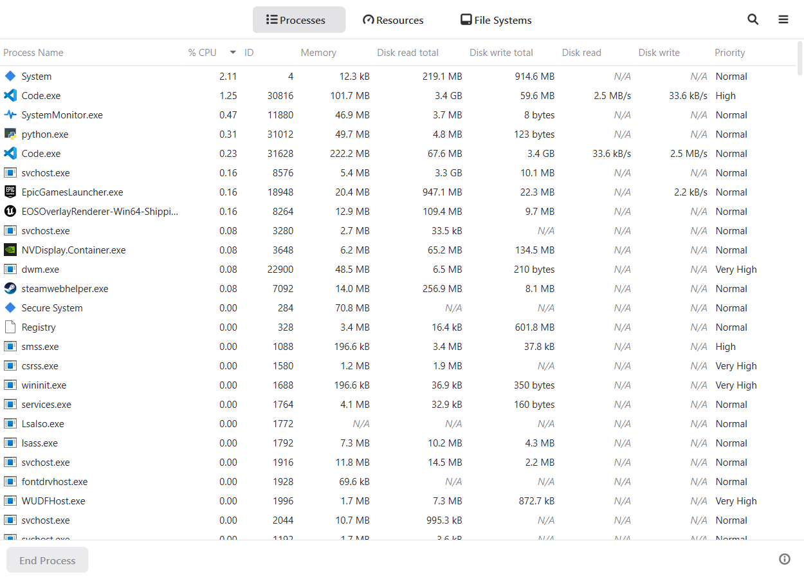
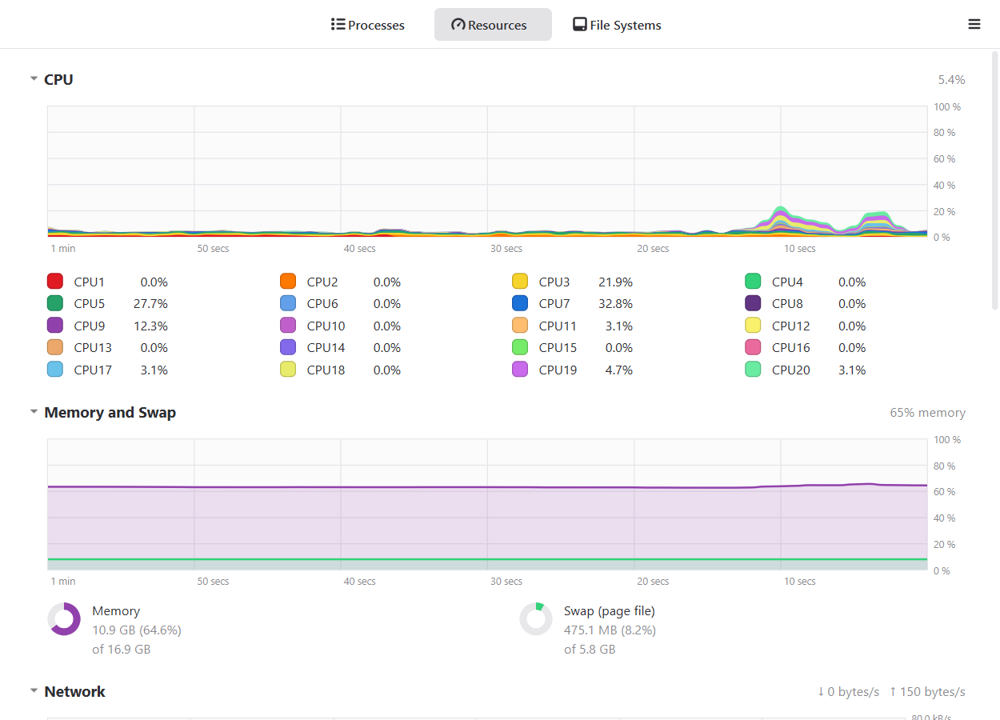
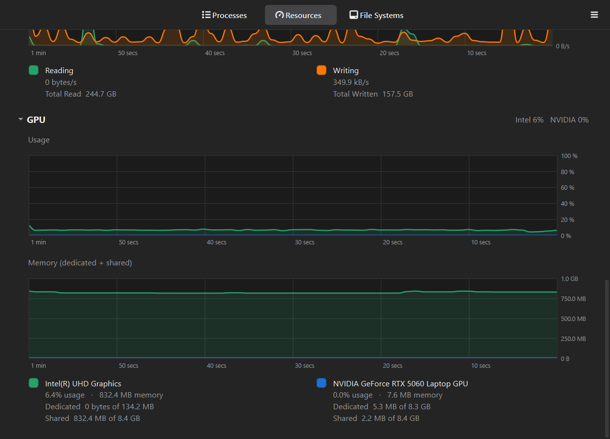

# System Monitor for Windows

A clean, easy-to-read Task Manager alternative for Windows 10 and 11, inspired by the
GNOME System Monitor on Ubuntu.



| Resources | GPU (dark mode) |
|---|---|
|  |  |

## Download and run

Go to the [**latest release**](../../releases/latest). Under **Assets**, pick one of the two downloads:

| Download | How to use it | Best for |
|---|---|---|
| **`SystemMonitor-<version>.exe`** | Download it and double-click it. That's all. | Trying it out, or keeping it on a USB stick |
| `SystemMonitor-<version>-win64.zip` | Right-click → **Extract All…**, open the folder, double-click `SystemMonitor.exe` | Everyday use: opens instantly (about 0.4 s instead of about 3 s) |

Both contain the same app. Nothing gets installed: no setup wizard, no admin rights, no Python needed.
- The single **.exe** unpacks itself to a temporary folder each time it starts, so it takes a few seconds to open.
- With the **zip** version, keep `SystemMonitor.exe` and the `_internal` folder next to it together;
  the app needs both. Don't run it from inside the zip without extracting it first.

**"Windows protected your PC"?** Releases aren't code-signed yet (signing through SignPath is
in progress), so Windows SmartScreen may warn the first time you run it. Click
**More info → Run anyway**. You can check the source code in this repository, or build the exe
yourself (see below).

**"Smart App Control blocked an app"?** Smart App Control (Windows 11) blocks all unsigned apps,
with no way to allow just one. Until releases are signed, you can either:
- run System Monitor from source (see [Build from source](#build-from-source); Python and Qt are signed,
  so Smart App Control allows them), or
- turn Smart App Control off: Windows Security → App & browser control → Smart App Control settings → Off.
  On many Windows versions it can't be turned back on without resetting Windows, so decide carefully.

**Pin it:** while it's running, right-click its taskbar icon → **Pin to taskbar**.

## What it shows

**Processes**
- Every running process with its app icon: % CPU, memory, disk read/write (totals and live speed),
  priority, plus optional User and % GPU columns
- Sort by any column; search by name or ID (Ctrl+F, or just start typing)
- **Show Dependencies** (☰ menu): view processes as a parent/child tree
- Right-click a process: End Process, End Process Tree, Change Priority, Open File Location,
  Copy name/ID, Properties (path, command line, start time, threads, handles)
- Filter to All, My or Active processes

**Resources**: live 60-second graphs
- CPU: a stacked graph with a colour for every core
- Memory and swap (page file)
- Network: download and upload speed
- Disk: read and write speed
- GPU: usage and memory for every graphics card (dedicated VRAM and shared memory)

**File Systems**
- Every drive with its size, free space and a usage bar (red when more than 90% full)
- Double-click a drive to open it in Explorer

It follows Windows' light or dark mode automatically. The refresh rate, theme and CPU display mode
can be changed under ☰ → **Preferences**. It's lightweight: about 50 MB of memory and well under 1% CPU.

## Keyboard shortcuts

| Keys | Action |
|---|---|
| Ctrl+1 / Ctrl+2 / Ctrl+3 | Processes / Resources / File Systems |
| Ctrl+F (or start typing) | Search processes |
| Esc | Close search |
| Delete | End the selected process |
| Ctrl+, | Preferences |
| Ctrl+Q | Quit |

## Good to know

- **"N/A" values or "Access denied":** Windows hides some details of system processes and of other
  users' processes from normal programs, and won't let you end them. Use
  ☰ → **Restart as Administrator** for full access.
- **Settings** are stored in the registry under `HKEY_CURRENT_USER\Software\SystemMonitor`.
- **Uninstall:** close the app, unpin it, and delete the `.exe` (or the extracted folder). Optionally
  also delete the registry key above.
- **Antivirus warning?** Single-file apps that unpack themselves are sometimes flagged by mistake
  (a known false positive with PyInstaller-built programs). The zip version is less likely to be flagged.
- **Requirements:** 64-bit Windows 10 (version 2004 or later) or Windows 11.

## Build from source

You need Python 3.13 or later.

```powershell
git clone https://github.com/vaibhavgshete/system-monitor-windows.git
cd system-monitor-windows
python -m venv .venv
.venv\Scripts\pip install -r requirements.txt -r requirements-dev.txt

.venv\Scripts\python run.py            # run from source
.venv\Scripts\python -m pytest -q      # run the tests
.\build.ps1                            # build both downloads into build\release\
```

Releases: push a tag like `v0.2.0` (matching `sysmon/__init__.py`), and GitHub Actions builds, tests,
signs and publishes the release. See [docs/signing.md](docs/signing.md).

`build.ps1` builds both versions from [`packaging/SystemMonitor.spec`](packaging/SystemMonitor.spec),
leaving out the Qt parts the app doesn't use. It then starts each exe in a self-test mode that
renders every tab, and fails the build if anything is broken. How the code is organised: [`CLAUDE.md`](CLAUDE.md). Roadmap: [`TASK.md`](TASK.md).

## Code signing policy

Releases are built from this repository's public source code by GitHub Actions
([`.github/workflows/release.yml`](.github/workflows/release.yml)). Once signing is set up, they will be
signed with free code signing provided by [SignPath.io](https://about.signpath.io/), with a certificate
from the [SignPath Foundation](https://signpath.org/). Details: [docs/signing.md](docs/signing.md).

- Committers and reviewers: [vaibhavgshete](https://github.com/vaibhavgshete)
- Approvers (sign off each signed release): [vaibhavgshete](https://github.com/vaibhavgshete)

**Privacy:** this program doesn't send any information to other computers or networks. It only reads
system information locally, and it stores its own settings in your Windows registry.

## License

[MIT](LICENSE). Bundled third-party components (Qt and PySide6 under LGPL-3.0, psutil under BSD)
are listed in [THIRD_PARTY_NOTICES.md](THIRD_PARTY_NOTICES.md). Inspired by GNOME System Monitor;
not affiliated with GNOME or Microsoft.
