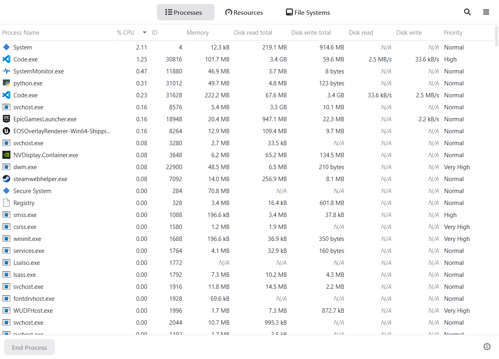
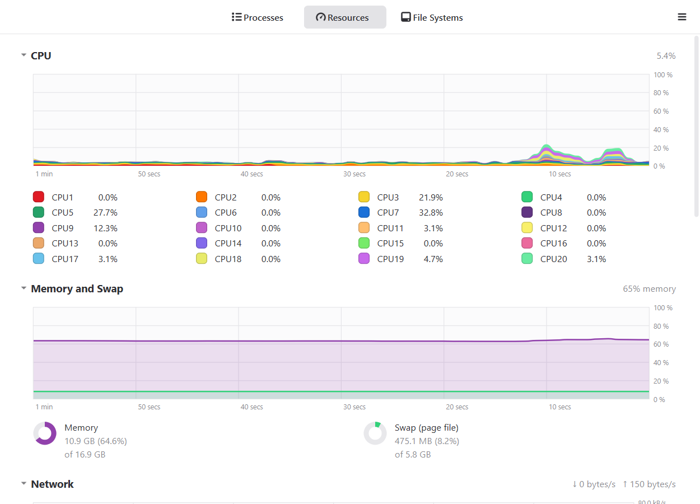
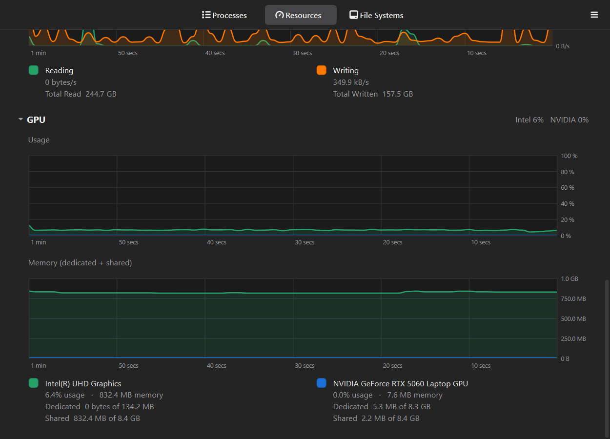

# System Monitor for Windows

A clean, easy-to-read Task Manager alternative for Windows 10 and 11, inspired by the
GNOME System Monitor on Ubuntu.



| Resources | GPU (dark mode) |
|---|---|
|  |  |

## Download and run

1. Go to the [**Releases**](../../releases/latest) page and download `SystemMonitor-<version>-win64.zip`.
2. Right-click the zip → **Extract All…**, and pick a folder to keep it in, for example
   `C:\Users\<you>\AppData\Local\Programs\SystemMonitor`.
3. Open the extracted folder and double-click **`SystemMonitor.exe`**.

Nothing gets installed. There's no setup wizard and no admin rights are needed. Keep
`SystemMonitor.exe` and the `_internal` folder next to it together; the app needs both.

**"Windows protected your PC"?** The app isn't code-signed (signing certificates cost money),
so Windows SmartScreen may warn the first time you run it. Click **More info → Run anyway**.
You can check the source code in this repository, or build the exe yourself (see below).

**Pin it:** while it's running, right-click its taskbar icon → **Pin to taskbar**.

## What it shows

**Processes**
- Every running process with its app icon: % CPU, memory, disk read/write (totals and live speed),
  priority, plus optional User and % GPU columns
- Sort by any column; search by name or ID (Ctrl+F, or just start typing)
- **Show Dependencies** (☰ menu): view processes as a parent/child tree
- Right-click a process: End Process, End Process Tree, Change Priority, Open File Location,
  Copy name/ID, Properties (path, command line, start time, threads, handles)
- Filter to All, My or Active processes

**Resources**: live 60-second graphs
- CPU: a stacked graph with a colour for every core
- Memory and swap (page file)
- Network: download and upload speed
- Disk: read and write speed
- GPU: usage and memory for every graphics card (dedicated VRAM and shared memory)

**File Systems**
- Every drive with its size, free space and a usage bar (red when more than 90% full)
- Double-click a drive to open it in Explorer

It follows Windows' light or dark mode automatically. The refresh rate, theme and CPU display mode
can be changed under ☰ → **Preferences**. It's lightweight: about 50 MB of memory and well under 1% CPU.

## Keyboard shortcuts

| Keys | Action |
|---|---|
| Ctrl+1 / Ctrl+2 / Ctrl+3 | Processes / Resources / File Systems |
| Ctrl+F (or start typing) | Search processes |
| Esc | Close search |
| Delete | End the selected process |
| Ctrl+, | Preferences |
| Ctrl+Q | Quit |

## Good to know

- **"N/A" values or "Access denied":** Windows hides some details of system processes and of other
  users' processes from normal programs, and won't let you end them. Use
  ☰ → **Restart as Administrator** for full access.
- **Settings** are stored in the registry under `HKEY_CURRENT_USER\Software\SystemMonitor`.
- **Uninstall:** close the app, unpin it, and delete its folder. Optionally also delete the
  registry key above.
- **Requirements:** 64-bit Windows 10 (version 2004 or later) or Windows 11.

## Build from source

You need Python 3.13 or later.

```powershell
git clone https://github.com/vaibhavgshete/system-monitor-windows.git
cd system-monitor-windows
python -m venv .venv
.venv\Scripts\pip install -r requirements.txt -r requirements-dev.txt

.venv\Scripts\python run.py            # run from source
.venv\Scripts\python -m pytest -q      # run the tests
.\build.ps1                            # build dist\SystemMonitor\SystemMonitor.exe (about 52 MB)
```

`build.ps1` also starts the finished exe in a self-test mode that renders every tab, and fails the
build if anything is broken. How the code is organised: [`CLAUDE.md`](CLAUDE.md). Roadmap: [`TASK.md`](TASK.md).

## License

[MIT](LICENSE). Bundled third-party components (Qt and PySide6 under LGPL-3.0, psutil under BSD)
are listed in [THIRD_PARTY_NOTICES.md](THIRD_PARTY_NOTICES.md). Inspired by GNOME System Monitor;
not affiliated with GNOME or Microsoft.
